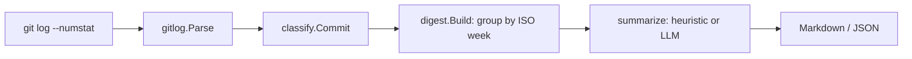

# gitlog-digest

A Go CLI that turns git history into a readable weekly changelog, offline by default with an optional LLM mode.

## Why

`git log` is chronological and noisy, and most changelog tools demand strict Conventional Commits or a paid API key. gitlog-digest groups real-world, imperfect commit history by ISO week and by kind of change, so a team can skim a week in a minute. It works with no network access; an LLM is only an optional upgrade for the weekly headline.

## Demo

Output of `go run ./cmd/gitlog-digest -repo . -since "1 week ago"` run on this project's own history while it was being built:

```text
# Weekly digest

## 2026-W43 (2026-10-19 to 2026-10-25)

9 commits by 1 author: 5 features, 1 fixes, 1 documentation, 1 tests, 1 build & ci. Highlight: add CLI with md/json output and optional LLM mode.

_9 commits, 1 author, +1058/-4 lines_

### Features

- add CLI with md/json output and optional LLM mode (`ef08194`, Naman Jain)
- heuristic and OpenAI-compatible summarizers with fallback (`64d151f`, Naman Jain)
- group commits by ISO week and render markdown/json (`e3fa812`, Naman Jain)
- classify commits by prefix, keyword and files (`35af83c`, Naman Jain)
- parse git log into commits (`e2ec198`, Naman Jain)

### Fixes

- singular author in weekly stats line (`ff56a3a`, Naman Jain)

### Documentation

- add design document (`c87e35f`, Naman Jain)

### Tests

- fix classify expectation for capitalised prefix (`7a4ea87`, Naman Jain)

### Build & CI

- add workflow, license, manifest and env example (`1a6ad57`, Naman Jain)
```

## Quick start

```sh
go run ./cmd/gitlog-digest -repo /path/to/repo -since "4 weeks ago"
```

Flags:

| Flag | Default | Meaning |
| --- | --- | --- |
| `-repo` | `.` | Path to the git repository |
| `-since` | `4 weeks ago` | Anything `git log --since` accepts |
| `-format` | `md` | `md` or `json` |
| `-llm` | off | Write weekly headlines with an OpenAI-compatible endpoint |

LLM mode works with OpenAI, Ollama, llama.cpp server or vLLM. Set `GITLOG_LLM_BASE_URL` and `GITLOG_LLM_MODEL` (and `GITLOG_LLM_API_KEY` if the server needs one); see `.env.example`. If the endpoint fails, the tool warns on stderr and uses the offline headline.

## How it works



Commits are classified by Conventional Commit prefix first, then by the first word of the subject, then by which files changed (for example only `_test.go` files means Tests). Weeks are ISO weeks in UTC, newest first.

## Design decisions

- Heuristics first, LLM optional: classification is deterministic, the model only rewrites the headline.
- Standard library only: no dependencies to vet.
- Records are parsed with ASCII separators rather than regexes over pretty output.
- LLM failures degrade to the offline headline instead of failing the run.
- ISO weeks in UTC keep output stable across machines.

Details and trade-offs: [docs/DESIGN.md](docs/DESIGN.md).

## Running tests

```sh
go vet ./... && go test ./...
```

Tests use real temporary git repositories and an `httptest` server for the LLM client, so they need only `git` and Go.

Built with Claude Code, reviewed by Naman Jain.
